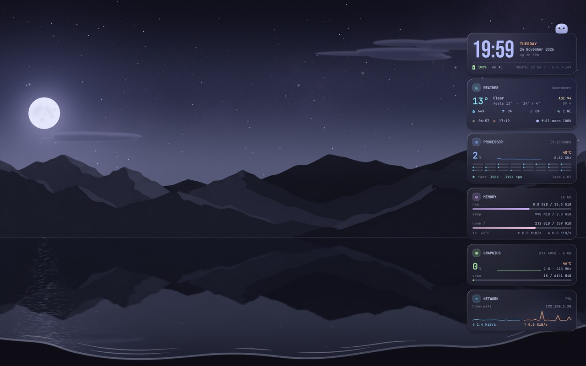
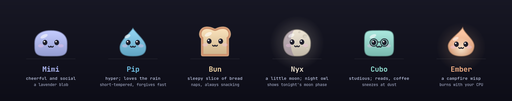

# living-sky

A conky desktop for GNOME whose wallpaper follows the real sky. The sun, moon (with its true phase), stars and
clouds are drawn for your location and the current weather over a painted scene; frosted cards show the time,
weather and your machine in colours that shift with the sky; and a little glob pet lives on them, reacting to the
time, the weather, the air, your music and your typing.

**[See it all on the website →](https://singletlinkage.github.io/living-sky/)** scenes, pets, cards, docs.

<p align="center"></p>

| glass, night | cards, day |
|---|---|
|  |  |



## Highlights
- **A living wallpaper:** four painted scenes (lake, forest, city, camp) relit through the day for the real sun,
  moon, season and weather; city windows light up in the evening, the campfire burns from dusk to dawn.
  Optional dithered pixel-art look.
- **Three card styles:** frosted glass, Catppuccin cards, or the same cards fully solid; clock, weather, CPU, memory, GPU, network, plus
  calendar, now playing, disks and battery. Hardware is detected automatically.
- **Six glob pets** (or a pet of the day, or the one that matches your scene), on the desktop and in the top panel.
- **A settings app** ("Living Sky"), or one plain config file; changes apply within seconds.
- **Light:** about 2 % of one CPU core; the heavy rendering runs once an hour at low priority.

## Install
GNOME on **X11** (Wayland isn't supported yet).
```sh
git clone https://github.com/SingletLinkage/living-sky ~/living-sky
cd ~/living-sky
./install.sh
```
The installer checks what's needed (conky 1.19+ with Lua cairo, Python 3 with numpy / OpenCV / Pillow / PyGObject /
python-xlib, GTK 4 + libadwaita, fonts) and offers to install what's missing through apt, dnf, pacman or zypper,
asks a few questions and starts it. `--yes` takes the defaults, `--dry-run` shows what it would do.
[Full install notes](https://singletlinkage.github.io/living-sky/#install).

## Use
```sh
living-sky start | stop | restart | status
living-sky settings              # the settings window (also in your apps, or right-click the panel pet)
living-sky set scene camp        # change one setting (set --list: all of them)
living-sky doctor                # what was detected, for bug reports
```
Settings live in `~/.config/living-sky/living-sky.conf`, documented in
[`living-sky.conf.example`](living-sky.conf.example). Every option is on the
[website](https://singletlinkage.github.io/living-sky/#configure).

## Privacy
One IP lookup for your location (unless you set coordinates) and weather from
[Open-Meteo](https://open-meteo.com) every 15 minutes. The pet notices only *which kind* of window is focused and
*that* a key went down, never titles or which key. Nothing else leaves your machine.

## Uninstall
```sh
./uninstall.sh                # keeps your settings (--purge removes them, --purge-deps the downloaded fonts / conky)
```

## Contributing
Bug reports, cards, pets and scenes are welcome: see [CONTRIBUTING.md](CONTRIBUTING.md) and
[how it works](docs/how-it-works.md). New card: [`lua/cards/README.md`](lua/cards/README.md); new pet:
[`lua/glob/README.md`](lua/glob/README.md).

## Credits
- Colours: [Catppuccin](https://github.com/catppuccin/catppuccin) (MIT).
- The scene paintings were generated with Google Gemini and traced into layers (`tools/trace_ridges.py`,
  `tools/trace_scenes.py`).

## License
[MIT](LICENSE). The art in `art/` is covered by the same license.
