# living-sky

A conky desktop for GNOME whose wallpaper follows the real sky. The sun, moon (with its true phase),
stars and clouds are drawn for your location and the current weather, the card palette shifts through
the Catppuccin flavours over the day in the accent colours you pick, and a glob pet (pick one of six)
lives on the cards and reacts to the time, weather, air quality, your music and your typing.

<p align="center"></p>

| glass, night | glass, day |
|---|---|
|  | 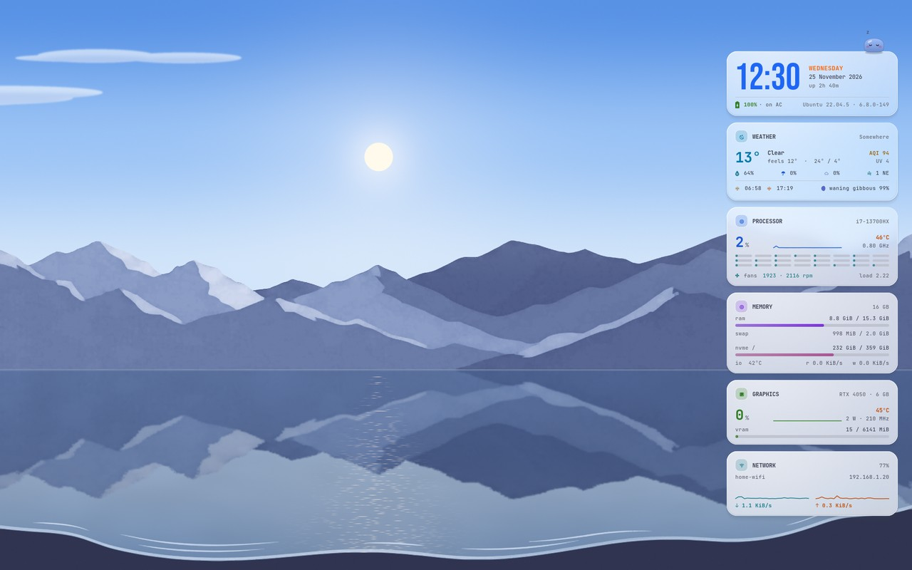 |
| **cards, night** | **cards, day** |
| 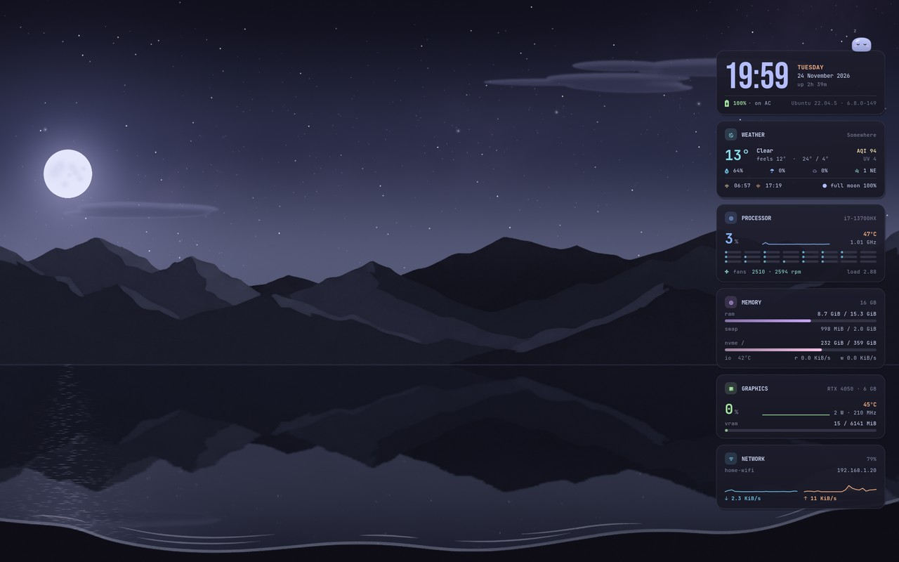 | 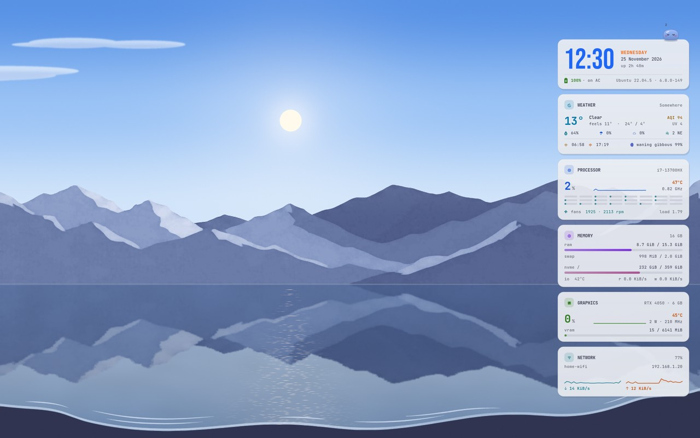 |


| Mimi | Pip | Bun | Nyx | Cubo | Ember |
|---|---|---|---|---|---|
| 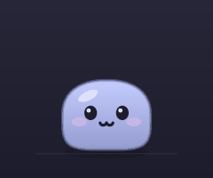 | 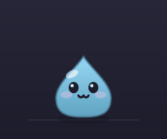 | 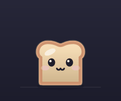 | 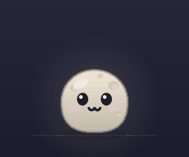 | 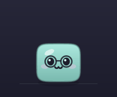 | 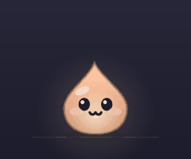 |

## Features
- **Living wallpaper:** re-rendered every hour (configurable) for the real sun and moon position:
  twilight glow, stars and the Milky Way, moonlight, and clouds, rain or fog from live weather.
  Four painted scenes, relit live for the hour, season and weather: **lake** (mountains with reflections),
  **forest** (rolling pine hills, valley mist at dawn, a cabin whose window glows and chimney smokes on cold
  evenings), **city** (windows that light up in the evening and go dark through the night) and **camp** (a
  tent in a forest clearing whose campfire burns from dusk to dawn). Any of them can be drawn as **pixel
  art** (`pixel = on`, dithered; [preview](art/demos/pixel.jpg)).
- **Seasons:** blended smoothly through the year for your hemisphere: the light and colours shift a little,
  the forest's larches turn gold in autumn, and snow settles on the peaks, boughs and roofs when it
  really snows or in a high-latitude winter ([preview](art/demos/seasons.jpg)).
- **Two card themes:** `glass` (frosted liquid-glass panes) and `cards` (solid Catppuccin cards):
  clock, weather (with sunrise/sunset and moon phase), CPU, memory/disk, GPU, network; optional calendar,
  now playing (any media player), disks and battery health.
  Hardware (CPU, sensors, fans, RAM, disk, battery, NVIDIA GPU) and screen size are detected automatically.
- **Your colours:** five soft pastel accent sets (`lavender`, `sakura`, `mint`, `peach`, `ocean`), your own
  pair of hex colours, or `auto`. Each is tuned very slightly through the day so it keeps its look on
  both the dark night cards and the light day cards ([preview](art/demos/colors.jpg)).
- **Glob pets:** six to choose from (Mimi, Pip, Bun, Nyx, Cubo, Ember), or a pet of the day, or the one that
  matches your scene; each with its own shape, colour,
  sleep schedule and personality. They all sleep, dance to music, watch videos, type along with you,
  wear sunglasses in strong sun and masks when the air is bad, snack, wander between cards, and get
  grumpy if you wake them or ignore them.
- **Panel pet** (optional GNOME extension): the same pet in the top bar; click to poke, double-click
  for a heart.
- Light on resources: about 2% of one CPU core; the heavy rendering runs once an hour at low priority.

<details><summary>Every look of every pet</summary>

[Mimi](art/glob/mimi/showcase.png) · [Pip](art/glob/pip/showcase.png) · [Bun](art/glob/bun/showcase.png) ·
[Nyx](art/glob/nyx/showcase.png) · [Cubo](art/glob/cubo/showcase.png) · [Ember](art/glob/ember/showcase.png)

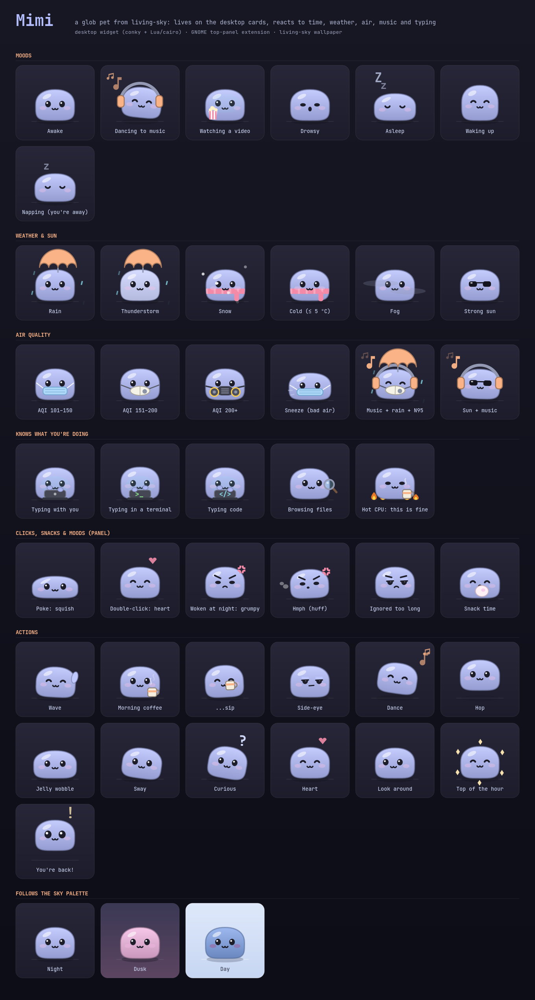
</details>

<details><summary>The four scenes through a day</summary>


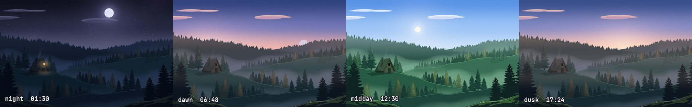
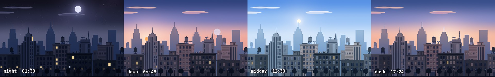
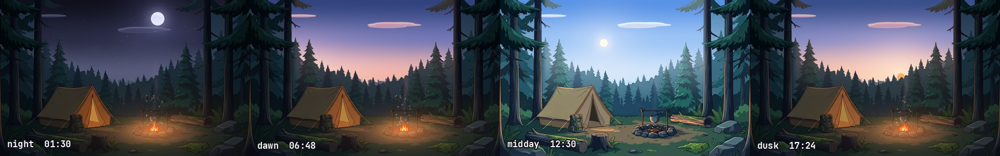
</details>

<details><summary>Every scene hour by hour</summary>

[lake](art/demos/hours/lake.jpg) · [forest](art/demos/hours/forest.jpg) · [city](art/demos/hours/city.jpg) ·
[camp](art/demos/hours/camp.jpg)
(24 renders each, made with `tools/daysheet.py`)

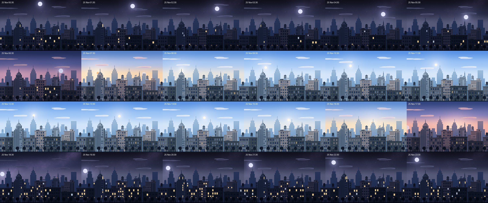
</details>

<details><summary>Each card (glass night · glass day · cards night · cards day)</summary>

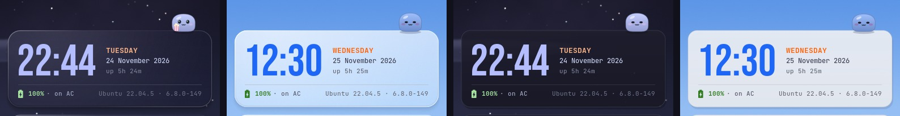
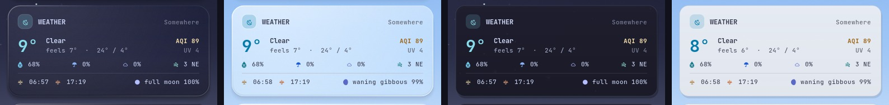
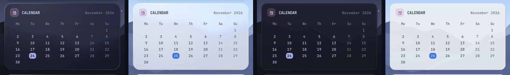
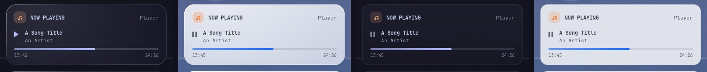
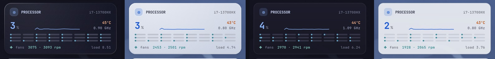
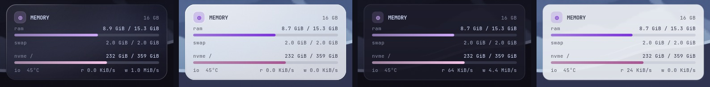
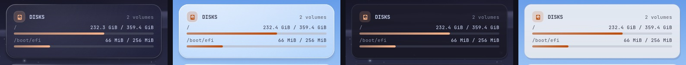
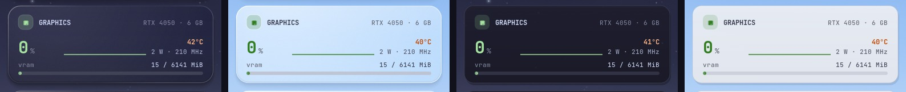
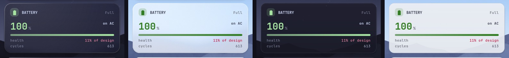
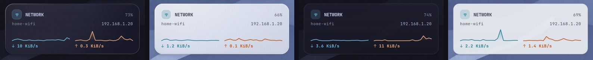

Made with `tools/cardshots.sh` (demo mode: placeholders for personal details).
</details>

<details><summary>All ten cards (the optional four wrap into a second column)</summary>

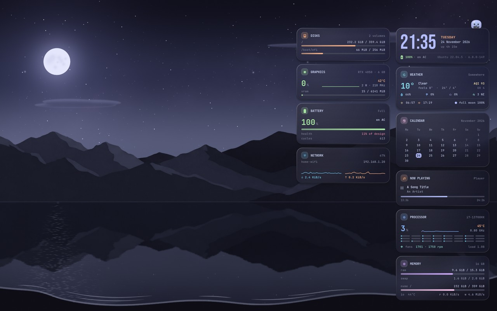
</details>

<details><summary>Close-up of the cards</summary>

| glass, night | glass, day | cards, night | cards, day |
|---|---|---|---|
| 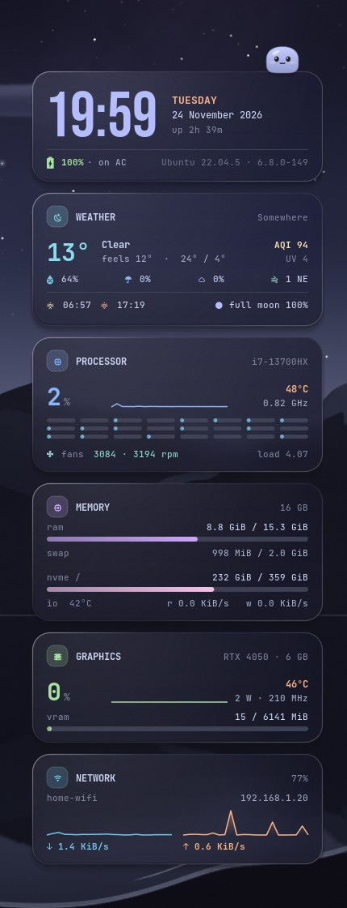 | 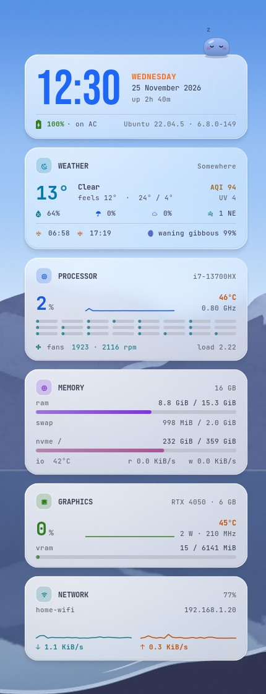 | 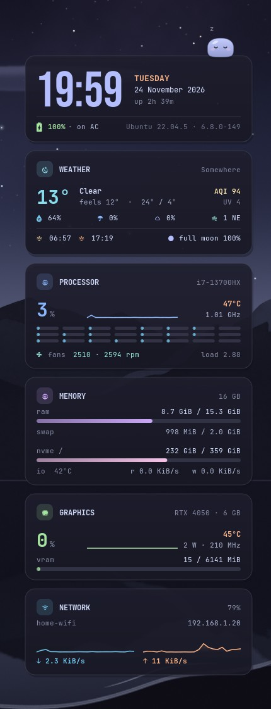 | 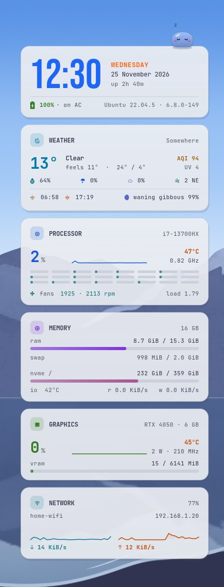 |
</details>

<details><summary>Colour sets through the day</summary>

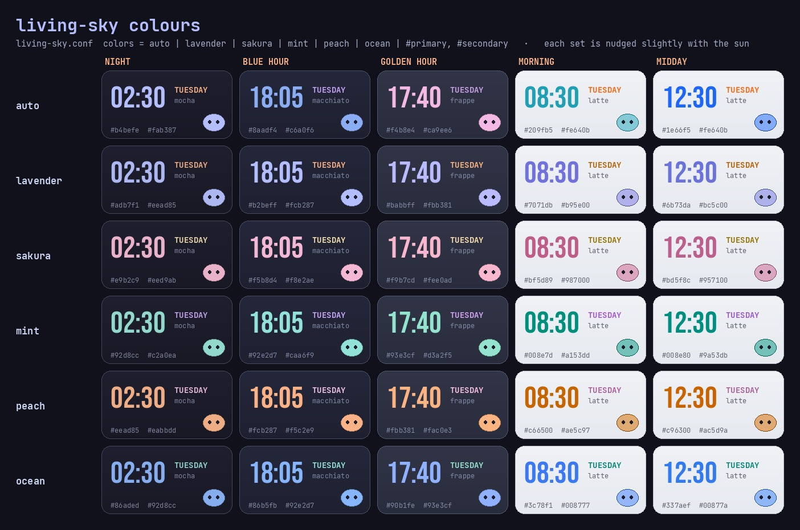
</details>

**Making your own card?** Each card is one small Lua file: see [`lua/cards/README.md`](lua/cards/README.md).
**Making your own pet?** See [`lua/glob/README.md`](lua/glob/README.md).

## Requirements
`install.sh` takes care of these (see Install).
- GNOME on **X11** (Wayland isn't supported yet). The panel pet works on GNOME 42–48.
- **conky 1.19+ with Lua cairo bindings**: `conky-all` from your distro, or the conky AppImage in
  `~/.local/opt/conky/` (used automatically if present; or set `CONKY_BIN`).
- Python 3 with `numpy`, `opencv`, `Pillow`, `PyGObject`, `python-xlib`
  (Debian/Ubuntu: `sudo apt install python3-numpy python3-opencv python3-pil python3-gi python3-xlib`).
- `curl`, `xrandr`, `gsettings`.
- Fonts: JetBrains Mono, FiraCode Nerd Font and Bebas Neue.
- Optional: `nvidia-smi` for the GPU card.

## Install
```sh
git clone https://github.com/SingletLinkage/living-sky ~/living-sky     # or unpack it anywhere
cd ~/living-sky
./install.sh
```
The installer:
- checks everything living-sky needs and offers to install what's missing: packages through your package
  manager (apt, dnf, pacman or zypper, with `sudo`, after asking), the conky AppImage when your distro's conky is
  missing, too old or lacks Lua cairo (plus libfuse2 for it), and the fonts (into `~/.local/share/fonts`);
- asks a few questions (card style, scene, colours, pet, units, clock, location, extra cards) and writes
  `~/.config/living-sky/living-sky.conf`;
- links the `living-sky` command into `~/.local/bin`, adds the **Living Sky** settings app to your app grid,
  adds a login autostart entry, installs the panel pet for your GNOME version (42–44, or 45+) if you want it,
  and starts it.

`./install.sh --yes` takes the defaults without questions, `--no-deps` only checks, `--dry-run` shows what it
would do. It runs from wherever you put the folder; nothing else is copied. After installing the panel pet,
log out and in once (on X11: Alt+F2, `r`).

## Use
```sh
living-sky start [glass|cards]   # start (default: `theme` in living-sky.conf)
living-sky stop                  # stop and restore your previous wallpaper
living-sky restart [theme]
living-sky status
living-sky preview [--demo]      # PNG of the current desktop (--demo hides Wi-Fi name, IP, place)
living-sky doctor                # what was detected, your settings, recent errors (for bug reports)
living-sky settings              # the settings window
living-sky set scene camp        # change one setting and apply it (set --list: all of them)
living-sky get scene
living-sky config                # living-sky.conf in your editor
living-sky logs [-f]             # recent log lines and errors
```

## Configure
Open **Living Sky** from your apps (or right-click the panel pet, or run `living-sky settings`): a GNOME
settings window with pages for the look (scene, season, pixel art, card style, with previews), colours and
pet, cards (on / off and their order, units, clock), location, and the system side (start / stop, start at
login, the panel pet, updates, diagnostics, uninstall). Changes apply right away.

The window edits one plain file, `~/.config/living-sky/living-sky.conf` (documented in
[`living-sky.conf.example`](living-sky.conf.example)), keeping its comments, so you can also edit it by hand
and save: the running desktop notices within about 5 seconds. Looks (colours, scene, season, pixel art,
units, clock) apply in place; changes to the style, pet, cards or location make it restart itself.
- **Look:** `theme` (glass / cards), `scene` (lake / forest / city / camp), `pixel` (on / off), `season` (auto or one
  of the four), `colors` (auto, five pastel sets, or your own two hex colours),
  `units` (metric / imperial), `clock` (24h / 12h).
  Weekday and month names follow your system language.
- **Cards:** `card_clock`, `card_weather`, `card_cpu`, `card_memory`, `card_gpu`, `card_network` (on by
  default) and `card_calendar`, `card_media`, `card_disks`, `card_battery` (off by default): on / off each;
  `cards = ...` sets their order. When they don't fit the screen height they continue in a second column.
- **Glob pet:** `glob = mimi | pip | bun | nyx | cubo | ember | random | scene | off` (`random`: a pet of the
  day; `scene`: lake → Pip, forest → Bun, city → Cubo, camp → Ember).
- **Sky & location:** `lat` / `lon` / `name` (by default the location is looked up once from your IP and
  cached; set them and `geo = off` to avoid that), `interval_min` (minutes between renders).

## Privacy
- Location: one IP-geolocation request (ipinfo.io, falling back to ipapi.co) unless you set coordinates.
  The result is cached in `~/.cache/living-sky/location.json`.
- Weather and air quality: [Open-Meteo](https://open-meteo.com) (no API key), every 15 min, with your coordinates.
- The pet's app awareness reads only the focused window's class (terminal / editor / files / browser),
  never window titles. Typing awareness only notes that *a* key went down (XInput2 or X RECORD, or
  the laptop keyboard's interrupt counter); which key is never read. Media detection reads the MPRIS playback state over D-Bus. Nothing leaves your machine.

## Uninstall
```sh
./uninstall.sh            # keeps ~/.config/living-sky and ~/.cache/living-sky
./uninstall.sh --purge    # removes them too
./uninstall.sh --purge-deps   # also the fonts and conky AppImage the installer downloaded (not your own conky)
```

## Project layout
```
app/              living_sky_settings.py (the GTK 4 / libadwaita settings window), its icon
bin/              living-sky (CLI), living-sky-run (conky supervisor), clickthrough.py
core/             sky.py (sky + palette renderer), scenes.py (the land: lake, forest, city, camp),
                  weather.py, glob-presence.py (D-Bus/X11 helper)
lua/desktop.lua   the engine: config, card runner, living-sky switching, pet host (both styles)
lua/cards/        one file per card + README.md (how to add or change a card)
lua/lib/          ui.lua (drawing kit), sys.lua (/proc, /sys readers, hardware detection)
lua/glob/         glob pets: core.lua (shared behaviour + drawing), one small file per pet, README.md
themes/           glass/ and cards/: conky.conf + a 4-line style selector
art/              lake/ forest/ city/ camp/ (each scene: source picture + traced layers), demos/ (previews), glob/<pet>/
gnome-extension/  glob@living-sky: the panel pet (pets/<pet>.js)
tests/            pytest suite (run by GitHub Actions: .github/workflows/ci.yml)
tools/            dev helpers: README media (media.sh, timelapse.py, gif.py), colour sheet, sky contact sheets, art tracing
docs/             how-it-works.md
```

## Credits
- Colours: [Catppuccin](https://github.com/catppuccin/catppuccin) (MIT).
- The scene pictures (`art/lake/wallpaper-static.png`, `art/{forest,city,camp}/source.jpg`) were generated
  with Google Gemini; the layers next to them were traced from them (`tools/trace_ridges.py`,
  `tools/trace_scenes.py`).
- Mascot behaviour ideas partly inspired by [mochi-desktop](https://github.com/miflow13/mochi-desktop)
  (no code or art copied).

## Contributing
Bug reports, cards, pets and scenes are welcome: see [CONTRIBUTING.md](CONTRIBUTING.md) (tests: `python3 -m pytest -q tests`).

## License
[MIT](LICENSE). The art in `art/` is covered by the same license.
